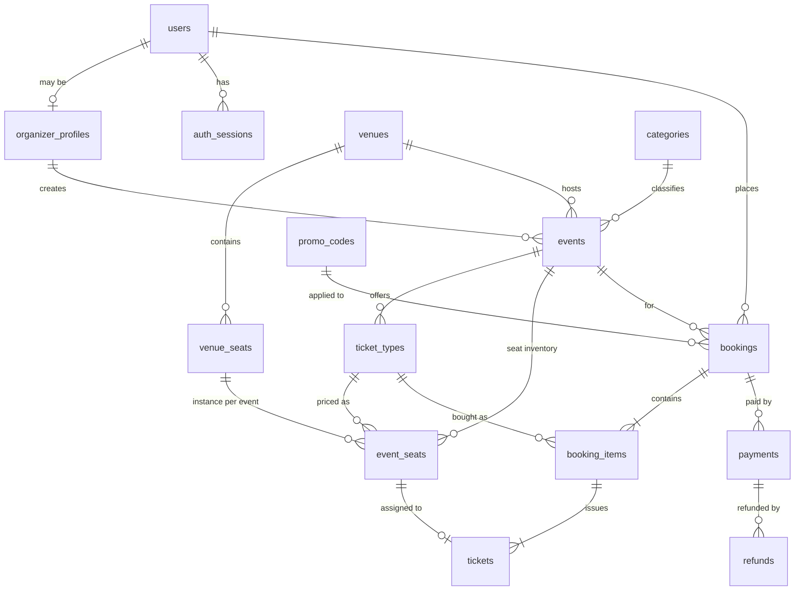

# Event Management System — Design

> Fresh design, independent of the current implementation.
> **Phase 1: Database design** (API, services and frontend come later).

---

## 1. Which database, and why

### Recommendation: **PostgreSQL** (primary store) + **Redis** (optional, later, for cache/rate-limits)

An event management system is at heart a **ticketing and payments system**. The data is:

- **Strongly relational**: users → organizers → events → ticket types → bookings → tickets → payments. Almost every screen joins three or more of these.
- **Money- and inventory-critical**: you must never sell seat A-12 twice, never sell 501 tickets when there are 500, and never mark a booking paid without a matching verified payment.
- **Concurrent at the worst moment**: when a popular event opens, hundreds of people try to book the same limited stock within seconds.

PostgreSQL handles each of these directly:

| Need | How PostgreSQL handles it |
|---|---|
| No overselling | Atomic conditional `UPDATE … WHERE sold + reserved + n <= total` plus `CHECK` constraints; the DB rejects invalid states even if app code has a bug |
| No double-booked seats | `UNIQUE` / partial unique indexes on `(event_id, seat_id)` for active holds |
| Booking + payment consistency | Full ACID transactions across many tables, `SELECT … FOR UPDATE` row locks |
| Payment idempotency (eSewa/Khalti callbacks arrive twice) | `UNIQUE (provider, provider_txn_id)` makes a duplicate callback a no-op |
| Reports (sales per event, revenue per organizer) | SQL `JOIN`, `GROUP BY`, window functions; no hand-written aggregation pipelines |
| Flexible bits (gateway raw responses, event metadata) | `JSONB` columns, so a document store isn't needed for these |
| Search and geo | Built-in full-text search (`tsvector`), `pg_trgm` for fuzzy search, PostGIS if "events near me" is needed |
| Timezones | `timestamptz` stores real instants; event local timezone kept separately |
| Hosting | Free/cheap managed options: Neon, Supabase, Railway, RDS |

### Why not MongoDB (what the project uses today)?

MongoDB is a good database, but it fits this domain less well:

- Multi-document transactions exist, but they need a replica set, cost more, and aren't idiomatic. Most Mongo code skips them, and that's where race conditions creep in.
- There are **no foreign keys and no cross-document constraints**, so "a ticket must belong to a real booking" or "sold ≤ capacity" are enforced only in application code.
- The data isn't document-shaped. Bookings, tickets and payments are separate entities with their own lifecycles, and embedding them causes unbounded arrays and update contention.
- Reporting relies on aggregation pipelines, which are more verbose than SQL for joins.

MongoDB fits better for schema-less content, high-volume logs or catalogs. A small amount of flexible data fits fine in Postgres `JSONB`.

### Why not MySQL?

MySQL would also work. Postgres wins on details that matter here: richer `CHECK` constraints, partial indexes, `JSONB`, exclusion constraints, `RETURNING`, native enums/`citext`, and better full-text and geo extensions.

### Suggested tooling (TypeScript backend)

- **ORM:** **Prisma** (chosen). Use raw SQL (`$queryRaw`) for the few hot inventory queries; see `backend.md` §3.1.
- **Migrations:** versioned, committed to the repo.
- **Redis (later):** caching event listings, rate limiting, short-lived locks/queues. **Never** the source of truth for inventory.

---

## 2. Core design decisions

1. **Primary keys:** `uuid` (v7 if available, else `gen_random_uuid()`). They're safe to expose in URLs and can't be enumerated. Human-facing codes (booking code, ticket code) are separate columns.
2. **Money:** stored as **integer minor units** (`bigint` paisa). `NPR 1,500.00` → `150000`. No floats, ever. Each money row also stores `currency char(3)`.
3. **Time:** all timestamps are `timestamptz` (UTC). Events also store an IANA `timezone` (e.g. `Asia/Kathmandu`) for display.
4. **Prices are snapshotted.** `booking_items.unit_price` copies the price at purchase time, so later price edits don't rewrite history.
5. **Inventory uses counters plus a reservation (hold) model:**
   - Booking created → stock moves to `quantity_reserved`, and the booking has `expires_at` (e.g. 10 min).
   - Payment verified → reserved moves to `quantity_sold`, tickets are issued.
   - Expired or cancelled → reserved is released.
6. **Status fields are Postgres enums** (or `text` + `CHECK`), and every state change is time-stamped.
7. **Soft delete** (`deleted_at`) only on user-facing content (events, venues). Financial rows (bookings, payments, tickets) are **never deleted**, only status-changed.
8. **Constraints live in the DB**, not just in validation code.

---

## 3. Entity overview



Two kinds of events are supported:
- **General admission:** inventory = `ticket_types.quantity_total`.
- **Reserved seating:** inventory = rows in `event_seats` (one per physical seat per event).

---

## 4. Tables

### 4.1 Identity & access

#### `users`
| Column | Type | Notes |
|---|---|---|
| id | uuid PK | |
| email | citext UNIQUE NOT NULL | case-insensitive, so no manual lowercasing |
| password_hash | text NULL | NULL for OAuth-only accounts |
| full_name | text NOT NULL | |
| phone | text NULL | |
| role | `user_role` NOT NULL default `'attendee'` | `attendee`, `organizer`, `admin` |
| status | `user_status` NOT NULL default `'active'` | `active`, `suspended`, `deleted` |
| email_verified_at | timestamptz NULL | |
| last_login_at | timestamptz NULL | |
| created_at / updated_at | timestamptz | |

#### `auth_sessions` (refresh tokens)
| Column | Type | Notes |
|---|---|---|
| id | uuid PK | |
| user_id | uuid FK → users ON DELETE CASCADE | |
| token_hash | text UNIQUE NOT NULL | store a **hash** of the refresh token, never the raw token |
| user_agent, ip | text | |
| expires_at | timestamptz NOT NULL | |
| revoked_at | timestamptz NULL | logout / rotation |
| created_at | timestamptz | |

#### `verification_tokens`
Email verification and password reset.
`id`, `user_id FK`, `purpose` (`email_verify` / `password_reset`), `token_hash UNIQUE`, `expires_at`, `used_at`, `created_at`.

#### `organizer_profiles`
One-to-one with a user whose role is organizer.
| Column | Type | Notes |
|---|---|---|
| user_id | uuid PK, FK → users | 1:1 |
| org_name | text NOT NULL | |
| slug | citext UNIQUE NOT NULL | public page `/o/:slug` |
| bio, logo_url, website | text | |
| verification_status | `org_verification` default `'pending'` | `pending`, `verified`, `rejected` |
| payout_method | text NULL | e.g. `esewa`, `khalti`, `bank` |
| payout_details | jsonb NULL | account info; encrypt at app level |
| created_at / updated_at | timestamptz | |

> The current code has a separate organizer model with its own login. This design uses **one `users` table** with a role and a profile table, so one account can buy tickets *and* organize. That avoids duplicate auth logic.

---

### 4.2 Catalog: venues, categories, events

#### `categories`
`id`, `name UNIQUE`, `slug UNIQUE`, `parent_id FK → categories NULL` (for sub-categories), `created_at`.

#### `venues`
| Column | Type | Notes |
|---|---|---|
| id | uuid PK | |
| owner_id | uuid FK → organizer_profiles NULL | NULL = platform-managed venue |
| name | text NOT NULL | |
| address_line, city, country | text | |
| latitude / longitude | numeric(9,6) NULL | or PostGIS `geography(Point)` |
| capacity | int NULL | CHECK (capacity > 0) |
| has_seat_map | boolean default false | |
| created_at / updated_at / deleted_at | timestamptz | |

#### `venue_seats` (physical seat map, reused by every event at that venue)
| Column | Type | Notes |
|---|---|---|
| id | uuid PK | |
| venue_id | uuid FK → venues ON DELETE CASCADE | |
| section | text NOT NULL | e.g. "Balcony" |
| row_label | text NOT NULL | "A" |
| seat_number | text NOT NULL | "12" |
| x, y | int NULL | coordinates for drawing the map |
| | | **UNIQUE (venue_id, section, row_label, seat_number)** |

#### `events`
| Column | Type | Notes |
|---|---|---|
| id | uuid PK | |
| organizer_id | uuid FK → organizer_profiles NOT NULL | |
| venue_id | uuid FK → venues NULL | NULL when online |
| category_id | uuid FK → categories NULL | |
| title | text NOT NULL | |
| slug | citext UNIQUE NOT NULL | |
| summary | text | short text for cards |
| description | text | rich text / markdown |
| cover_image_url | text | |
| mode | `event_mode` NOT NULL | `in_person`, `online`, `hybrid` |
| online_url | text NULL | revealed only to ticket holders |
| seating_type | `seating_type` NOT NULL | `general_admission`, `reserved` |
| starts_at / ends_at | timestamptz NOT NULL | CHECK (ends_at > starts_at) |
| timezone | text NOT NULL default `'Asia/Kathmandu'` | |
| status | `event_status` NOT NULL default `'draft'` | `draft`, `published`, `cancelled`, `completed` |
| visibility | `event_visibility` default `'public'` | `public`, `unlisted`, `private` |
| published_at, cancelled_at | timestamptz NULL | |
| cancellation_reason | text NULL | |
| metadata | jsonb default '{}' | tags, FAQs, extra fields |
| search_vector | tsvector GENERATED | from title + summary + description |
| created_at / updated_at / deleted_at | timestamptz | |

Constraint: `CHECK (mode = 'online' OR venue_id IS NOT NULL)`. In-person events must have a venue.

#### `ticket_types` (tiers: Early Bird, VIP, General…)
| Column | Type | Notes |
|---|---|---|
| id | uuid PK | |
| event_id | uuid FK → events ON DELETE CASCADE | |
| name | text NOT NULL | UNIQUE (event_id, name) |
| description | text | |
| price | bigint NOT NULL | minor units; CHECK (price >= 0), so 0 = free |
| currency | char(3) default `'NPR'` | |
| quantity_total | int NOT NULL | CHECK (> 0) |
| quantity_reserved | int NOT NULL default 0 | in pending (unpaid) bookings |
| quantity_sold | int NOT NULL default 0 | |
| min_per_order / max_per_order | int default 1 / 10 | |
| sales_start_at / sales_end_at | timestamptz NULL | |
| is_active | boolean default true | |
| sort_order | int default 0 | |
| version | int default 0 | optimistic locking for organizer edits |

**Key constraint:**
```sql
CHECK (quantity_reserved >= 0 AND quantity_sold >= 0
       AND quantity_reserved + quantity_sold <= quantity_total)
```

#### `event_seats` (only for `seating_type = 'reserved'`)
One row per seat per event, created when a reserved-seating event is published.
| Column | Type | Notes |
|---|---|---|
| id | uuid PK | |
| event_id | uuid FK → events ON DELETE CASCADE | |
| venue_seat_id | uuid FK → venue_seats | |
| ticket_type_id | uuid FK → ticket_types | sets the seat's price tier |
| status | `seat_status` default `'available'` | `available`, `held`, `sold`, `blocked` |
| held_by_booking_id | uuid FK → bookings NULL | |
| hold_expires_at | timestamptz NULL | |
| | | **UNIQUE (event_id, venue_seat_id)**: a seat exists once per event |

A seat is claimed with a single atomic statement:
```sql
UPDATE event_seats
SET status = 'held', held_by_booking_id = $booking, hold_expires_at = now() + interval '10 min'
WHERE id = ANY($seat_ids) AND status = 'available'
RETURNING id;
-- if fewer rows returned than requested → rollback, seat already taken
```

---

### 4.3 Commerce: bookings, tickets, payments

#### `promo_codes`
| Column | Type | Notes |
|---|---|---|
| id | uuid PK | |
| event_id | uuid FK → events NULL | NULL = organizer-wide |
| organizer_id | uuid FK → organizer_profiles NOT NULL | |
| code | citext NOT NULL | UNIQUE (organizer_id, code) |
| discount_type | `discount_type` | `percent`, `fixed` |
| discount_value | bigint NOT NULL | percent (1–100) or minor units |
| max_redemptions | int NULL | |
| times_redeemed | int default 0 | CHECK (times_redeemed <= max_redemptions) |
| valid_from / valid_until | timestamptz NULL | |

#### `bookings` (an order)
| Column | Type | Notes |
|---|---|---|
| id | uuid PK | |
| booking_code | text UNIQUE NOT NULL | human-friendly, e.g. `EVT-7K3Q9P` |
| user_id | uuid FK → users NOT NULL | |
| event_id | uuid FK → events NOT NULL | |
| status | `booking_status` NOT NULL default `'pending'` | `pending`, `confirmed`, `cancelled`, `expired`, `refunded`, `partially_refunded` |
| subtotal | bigint NOT NULL | sum of items |
| discount_amount | bigint default 0 | |
| fee_amount | bigint default 0 | platform/service fee |
| total_amount | bigint NOT NULL | CHECK (total_amount = subtotal - discount_amount + fee_amount AND total_amount >= 0) |
| currency | char(3) NOT NULL | |
| promo_code_id | uuid FK → promo_codes NULL | |
| expires_at | timestamptz NOT NULL | payment deadline for the hold |
| confirmed_at, cancelled_at | timestamptz NULL | |
| idempotency_key | text NULL | UNIQUE (user_id, idempotency_key): double-clicking "Book" creates one booking |
| contact_email, contact_phone | text | |
| created_at / updated_at | timestamptz | |

#### `booking_items`
| Column | Type | Notes |
|---|---|---|
| id | uuid PK | |
| booking_id | uuid FK → bookings ON DELETE CASCADE | |
| ticket_type_id | uuid FK → ticket_types NOT NULL | |
| quantity | int NOT NULL | CHECK (quantity > 0) |
| unit_price | bigint NOT NULL | **snapshot** of price at booking time |
| line_total | bigint NOT NULL | CHECK (line_total = unit_price * quantity) |
| | | UNIQUE (booking_id, ticket_type_id) |

#### `tickets` (one row per admission, issued only after payment)
| Column | Type | Notes |
|---|---|---|
| id | uuid PK | |
| ticket_code | text UNIQUE NOT NULL | random, unguessable; encoded in the QR |
| booking_item_id | uuid FK → booking_items NOT NULL | |
| event_id | uuid FK → events NOT NULL | denormalized for fast check-in lookup |
| ticket_type_id | uuid FK → ticket_types NOT NULL | denormalized |
| event_seat_id | uuid FK → event_seats NULL | UNIQUE where not NULL: one ticket per seat |
| holder_name, holder_email | text NULL | ticket can be assigned to a guest |
| status | `ticket_status` default `'valid'` | `valid`, `checked_in`, `cancelled`, `refunded` |
| checked_in_at | timestamptz NULL | |
| checked_in_by | uuid FK → users NULL | staff/organizer who scanned |
| created_at | timestamptz | |

Check-in becomes an atomic, scan-twice-safe statement:
```sql
UPDATE tickets SET status = 'checked_in', checked_in_at = now(), checked_in_by = $staff
WHERE ticket_code = $code AND event_id = $event AND status = 'valid'
RETURNING id;   -- 0 rows → invalid, already used, or wrong event
```

#### `payments` (one booking can have several attempts)
| Column | Type | Notes |
|---|---|---|
| id | uuid PK | |
| booking_id | uuid FK → bookings NOT NULL | |
| provider | `payment_provider` NOT NULL | `esewa`, `khalti`, `stripe`, `free` |
| amount | bigint NOT NULL | must equal booking total when verified |
| currency | char(3) NOT NULL | |
| status | `payment_status` default `'initiated'` | `initiated`, `pending`, `succeeded`, `failed`, `cancelled`, `refunded` |
| provider_txn_id | text NULL | gateway's transaction/pidx id |
| provider_payload | jsonb NULL | raw verify/lookup response for audits |
| failure_reason | text NULL | |
| initiated_at, completed_at | timestamptz | |
| | | **UNIQUE (provider, provider_txn_id)**: duplicate callbacks are no-ops |

Partial unique index, **at most one successful payment per booking**:
```sql
CREATE UNIQUE INDEX one_success_per_booking
  ON payments (booking_id) WHERE status = 'succeeded';
```

#### `refunds`
`id`, `payment_id FK`, `amount bigint CHECK (> 0)`, `reason`, `status` (`requested`, `processing`, `succeeded`, `failed`), `provider_refund_id`, `requested_by FK → users`, `created_at`, `completed_at`.

#### `payment_webhook_events` (raw inbox for gateway callbacks)
`id`, `provider`, `event_key text` (provider's unique id/signature), `payload jsonb`, `received_at`, `processed_at`, `error`.
**UNIQUE (provider, event_key)**. Store first, process after, so nothing is lost if processing crashes.

---

### 4.4 Supporting

#### `event_staff` (who may scan tickets / co-manage an event)
`event_id FK`, `user_id FK`, `role` (`manager`, `scanner`), PK `(event_id, user_id)`.

#### `notifications` (outbox)
`id`, `user_id FK`, `type` (`booking_confirmed`, `event_cancelled`, …), `channel` (`email`, `sms`), `payload jsonb`, `status` (`queued`, `sent`, `failed`), `attempts`, `sent_at`, `created_at`.
Written **in the same transaction** as the booking confirmation. A worker sends them later (transactional outbox pattern).

#### `audit_logs`
`id bigserial`, `actor_id FK → users NULL`, `action text` (`event.publish`, `booking.refund`), `entity_type`, `entity_id`, `diff jsonb`, `ip`, `created_at`. Append-only.

---

## 5. Lifecycles (state machines)

**Event:** `draft → published → completed`; `draft/published → cancelled`.
Cancelling a published event refunds every `confirmed` booking.

**Booking:**
```
pending ──(payment verified)──▶ confirmed ──(refund all)──▶ refunded
   │                                 └──(refund some)──▶ partially_refunded
   ├──(expires_at passed)──▶ expired
   └──(user cancels)───────▶ cancelled
```
Only `pending` bookings hold reserved inventory. Free events go straight `pending → confirmed` with a `provider = 'free'` payment row.

**Payment:** `initiated → pending → succeeded | failed | cancelled`; `succeeded → refunded`.

**Ticket:** `valid → checked_in`; `valid → cancelled | refunded`.

---

## 6. Critical flows at the DB level

### 6.1 Create booking (general admission)
One transaction:
```sql
BEGIN;
-- 1. reserve stock atomically per ticket type (no SELECT-then-UPDATE race)
UPDATE ticket_types
SET quantity_reserved = quantity_reserved + $qty
WHERE id = $tt AND event_id = $event AND is_active
  AND now() BETWEEN coalesce(sales_start_at, '-infinity') AND coalesce(sales_end_at, 'infinity')
  AND quantity_reserved + quantity_sold + $qty <= quantity_total
RETURNING price;
-- 0 rows → sold out / not on sale → ROLLBACK

-- 2. insert bookings (status pending, expires_at = now() + 10 min)
-- 3. insert booking_items with unit_price = returned price
COMMIT;
```

### 6.2 Confirm after payment verification
One transaction:
1. Insert/update `payments` row to `succeeded` (unique constraints block duplicates).
2. `UPDATE bookings SET status='confirmed' WHERE id=$id AND status='pending'`. If 0 rows, it was already handled or expired (expired-but-paid → auto refund).
3. Move counters: `quantity_reserved -= n, quantity_sold += n`.
4. Insert one `tickets` row per unit; for reserved seats set `event_seats.status='sold'`.
5. Insert `notifications` row (confirmation email).

### 6.3 Expiry job (every minute)
```sql
UPDATE bookings SET status = 'expired'
WHERE status = 'pending' AND expires_at < now()
RETURNING id;
-- then, same transaction: release quantity_reserved and event_seats holds for those ids
```
Use `FOR UPDATE SKIP LOCKED` so multiple workers never fight over the same rows.

---

## 7. Indexes (beyond PKs and the UNIQUEs above)

| Table | Index | Serves |
|---|---|---|
| events | `(status, starts_at)` WHERE deleted_at IS NULL | public listing "upcoming events" |
| events | `(organizer_id, created_at DESC)` | organizer dashboard |
| events | GIN `(search_vector)` | search |
| events | `(category_id, starts_at)` | browse by category |
| ticket_types | `(event_id)` | event page |
| event_seats | `(event_id, status)` | seat map rendering |
| event_seats | `(hold_expires_at)` WHERE status = 'held' | expiry job |
| bookings | `(user_id, created_at DESC)` | "My bookings" |
| bookings | `(event_id, status)` | organizer sales view |
| bookings | `(expires_at)` WHERE status = 'pending' | expiry job |
| booking_items | `(booking_id)` | |
| tickets | `(event_id, status)` | check-in stats |
| tickets | `(booking_item_id)` | |
| payments | `(booking_id)` | |
| auth_sessions | `(user_id)` WHERE revoked_at IS NULL | |

Every FK column gets an index; Postgres doesn't create them automatically.

---

## 8. Enum reference

```sql
CREATE TYPE user_role        AS ENUM ('attendee','organizer','admin');
CREATE TYPE user_status      AS ENUM ('active','suspended','deleted');
CREATE TYPE org_verification AS ENUM ('pending','verified','rejected');
CREATE TYPE event_mode       AS ENUM ('in_person','online','hybrid');
CREATE TYPE seating_type     AS ENUM ('general_admission','reserved');
CREATE TYPE event_status     AS ENUM ('draft','published','cancelled','completed');
CREATE TYPE event_visibility AS ENUM ('public','unlisted','private');
CREATE TYPE seat_status      AS ENUM ('available','held','sold','blocked');
CREATE TYPE booking_status   AS ENUM ('pending','confirmed','cancelled','expired','refunded','partially_refunded');
CREATE TYPE ticket_status    AS ENUM ('valid','checked_in','cancelled','refunded');
CREATE TYPE payment_provider AS ENUM ('esewa','khalti','stripe','free');
CREATE TYPE payment_status   AS ENUM ('initiated','pending','succeeded','failed','cancelled','refunded');
CREATE TYPE discount_type    AS ENUM ('percent','fixed');
```

---

## 9. Out of scope for v1 (schema leaves room)

- Reviews/ratings (`event_reviews`: user, event, rating, body; UNIQUE (user, event), only for checked-in attendees)
- Waitlists for sold-out ticket types
- Recurring events / multi-session events (`event_sessions` table under `events`)
- Organizer payouts and settlement ledger
- Multi-currency pricing

---

## 10. Next steps

1. Review and finalize this schema (open questions below).
2. Write the first migration (enums → tables → constraints → indexes).
3. Seed script (categories, a demo venue with seat map, sample events).
4. Then: **API design** (resources, endpoints, auth rules) in the next section of this doc.

**Open questions to decide:**
- Is reserved seating needed for v1, or only general admission? (Dropping it removes `venue_seats` / `event_seats`.)
- Can one account be both attendee and organizer? (This design says yes.)
- Hold duration before an unpaid booking expires: 10 min?
- Do organizers need co-managers/scanners at launch (`event_staff`)?
